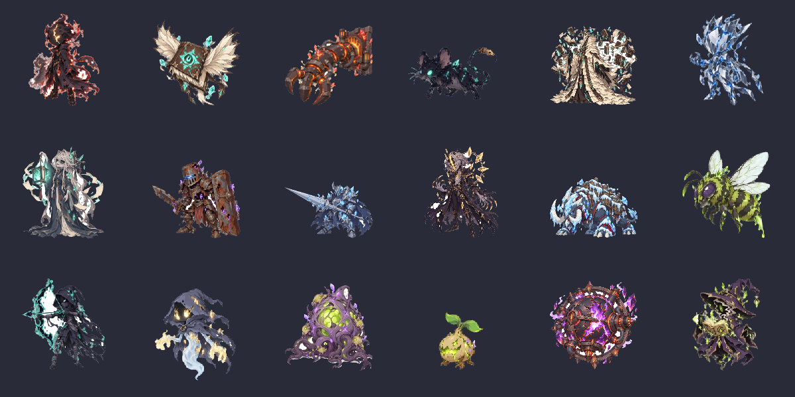

# Toàn bộ quái đã đưa vào game — 15/10/2026

18 họ, 33 biến thể, 55 chiêu khác nhau (85 bộ chiêu theo biến thể). Các bản mới chờ bạn duyệt hình. [Báo cáo tích hợp](../docs/DESIGN_ENEMY_IMPORT.md).

Ngoài danh sách chính bên dưới, đã bổ sung hình cho cả 6 mẫu không có `family`: 3 id cũ dùng lại hình đúng biến thể, 2 bù nhìn tập và quái thử cân bằng có atlas SVG riêng. Phòng thử hiện đủ 39 quái. [Ảnh bù nhìn trong game](_reports/enemy_cast/ingame_training_dummy.png).

| Họ quái | Biến thể | Chiêu | Xem |
| --- | --- | --- | --- |
| `devourer_clone` | 3 | 2 | [Trận](quai/devourer_clone/5_render/preview/battle_all.png) · [Map](quai/devourer_clone/5_render/devourer_clone_flame/preview/map_run.gif) |
| `flying_book` | 1 | 1 | [Trận](quai/flying_book/5_render/preview/battle_all.png) · [Map](quai/flying_book/5_render/flying_book/preview/map_run.gif) |
| `furnace_arm` | 1 | 2 | [Trận](quai/furnace_arm/5_render/preview/battle_all.png) · [Map](quai/furnace_arm/5_render/furnace_arm/preview/map_run.gif) |
| `ink_rat` | 2 | 2 | [Trận](quai/ink_rat/5_render/preview/battle_all.png) · [Map](quai/ink_rat/5_render/ink_rat_lightning/preview/map_run.gif) |
| `library_warden` | 1 | 4 | [Trận](quai/library_warden/5_render/preview/battle_all.png) · [Map](quai/library_warden/5_render/library_warden/preview/map_run.gif) |
| `mirror_shade` | 2 | 3 | [Trận](quai/mirror_shade/5_render/preview/battle_all.png) · [Map](quai/mirror_shade/5_render/mirror_shade_soul/preview/map_run.gif) |
| `mute_librarian` | 1 | 3 | [Trận](quai/mute_librarian/5_render/preview/battle_all.png) · [Map](quai/mute_librarian/5_render/mute_librarian/preview/map_run.gif) |
| `rusted_knight` | 2 | 3 | [Trận](quai/rusted_knight/5_render/preview/battle_all.png) · [Map](quai/rusted_knight/5_render/rusted_knight_lightning/preview/map_run.gif) |
| `shattered_knight` | 1 | 3 | [Trận](quai/shattered_knight/5_render/preview/battle_all.png) · [Map](quai/shattered_knight/5_render/shattered_knight/preview/map_run.gif) |
| `soul_devourer` | 1 | 5 | [Trận](quai/soul_devourer/5_render/preview/battle_all.png) · [Map](quai/soul_devourer/5_render/soul_devourer/preview/map_run.gif) |
| `vault_behemoth` | 1 | 6 | [Trận](quai/vault_behemoth/5_render/preview/battle_all.png) · [Map](quai/vault_behemoth/5_render/vault_behemoth/preview/map_run.gif) |
| `venom_bee` | 4 | 3 | [Trận](quai/venom_bee/5_render/preview/battle_all.png) · [Map](quai/venom_bee/5_render/venom_bee_poison/preview/map_run.gif) |
| `void_archer` | 2 | 3 | [Trận](quai/void_archer/5_render/preview/battle_all.png) · [Map](quai/void_archer/5_render/void_archer_lightning/preview/map_run.gif) |
| `wandering_shade` | 3 | 2 | [Trận](quai/wandering_shade/5_render/preview/battle_all.png) · [Map](quai/wandering_shade/5_render/wandering_shade_soul/preview/map_run.gif) |
| `warp_matrix` | 1 | 3 | [Trận](quai/warp_matrix/5_render/preview/battle_all.png) · [Map](quai/warp_matrix/5_render/warp_matrix/preview/map_run.gif) |
| `warp_sprout` | 3 | 2 | [Trận](quai/warp_sprout/5_render/preview/battle_all.png) · [Map](quai/warp_sprout/5_render/warp_sprout_fire/preview/map_run.gif) |
| `warped_core` | 1 | 3 | [Trận](quai/warped_core/5_render/preview/battle_all.png) · [Map](quai/warped_core/5_render/warped_core/preview/map_run.gif) |
| `warped_mage` | 3 | 5 | [Trận](quai/warped_mage/5_render/preview/battle_all.png) · [Map](quai/warped_mage/5_render/warped_mage_fire/preview/map_run.gif) |
